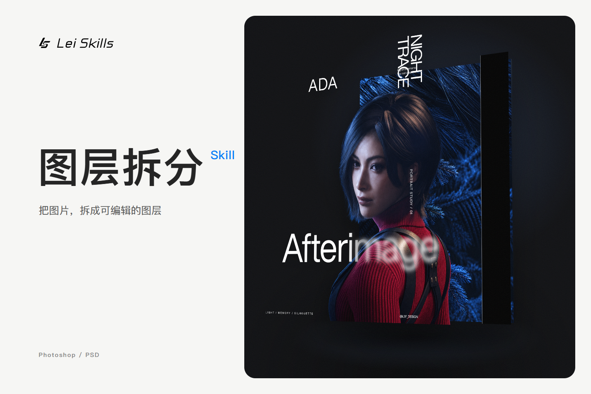

# 图片拆层 · PS 普通版

[](https://hub.xerj.org/contributors/leishifu666)

把一张图片重建为可以继续修改的 Photoshop 分层 PSD。

普通版免费开源，包含原生文字编辑；Figma 重建与专属流程不在本仓库中。这里发布的是独立的 PS 版本，不携带私人总仓库或其他版本的历史。



[查看封面 HTML 与组件源码](examples/cover/)

## 能做什么

- 将主体、装饰、文字和背景拆成独立图层，按原图位置与真实遮挡顺序组装。
- 对复杂位图逐元素修复、补全遮挡，并输出真实透明 PNG 和完整背景。
- 核验字体和原文，将普通文字重建为可直接改字的原生文字层；字体不能确认时提供候选同文对比图，由你接受后应用。
- 原生保留能准确复现的填充、渐变与规则形状。特殊字标和复杂材质可保留图形/位图，并说明编辑边界。
- 使用当前客户端的内置生图工具，或你自己配置的受支持 API。
- 输出原尺寸、2K（长边 2048）、4K（长边 4096）或自定义尺寸。放大素材会注明非原生细节。

完整任务交付：PSD、独立透明 PNG、完整背景 PNG、真实图层合成预览，以及必要的字体/尺寸/验证说明。

## 使用前准备

这是给 AI 客户端使用的 skill，不是双击运行的独立软件，也不附送模型、额度、字体或 Photoshop。

以 Codex 为例：需要能读取图片、操作本地文件并准备运行依赖的环境；复杂位图修复还需要内置生图能力或你明确配置的 API。生成 PSD 可以用文件写入库，最终是否在 Photoshop 实测需分别说明。

- 普通使用：让客户端按任务需要准备依赖，不必先执行所有脚本。
- 自定义 API：Python 3.10+、Pillow，安装 python -m pip install -r requirements.txt。
- 使用附带的简单文字 PSD 写入脚本：Node.js 22+，在任务运行库安装 ag-psd@31.0.3、@napi-rs/canvas@1.0.11、fontkit@2.0.4；详见 [文字写入说明](references/ps-editable-text.md)。

第三方服务、字体与编辑器的费用和权限独立；开源不等于无限免费生图。

## 安装到 Codex

### 让 Codex 安装

把下面这句发给 Codex：

> 请安装这个 skill：https://github.com/leishifu666/lsf-image-to-layered-psd 。安装后检查 SKILL.md、references 和 scripts 是否齐全，并告诉我如何调用。

本仓库根目录就是 skill 目录，技能名为 lsf-image-to-layered-psd。

### 手动安装

下载仓库，将完整文件夹命名为 lsf-image-to-layered-psd，并放到用户技能目录：

- Windows：%USERPROFILE%/.agents/skills/lsf-image-to-layered-psd/
- macOS / Linux：~/.agents/skills/lsf-image-to-layered-psd/

里面应直接包含 SKILL.md、references/、scripts/，不要只复制入口文件或多套一层目录。已有同名版本时先比较、保留本地修改，不盲目覆盖。

Codex 会自动发现；未出现时再重启。也可使用已配置的 skills CLI：

```text
npx skills add leishifu666/lsf-image-to-layered-psd --skill lsf-image-to-layered-psd -a codex -g
```

skills CLI 有自己的 Node.js 要求；不使用它也能通过上面的方式安装。参考：[Codex 技能说明](https://learn.chatgpt.com/docs/build-skills)、[skills CLI](https://github.com/vercel-labs/skills)。

## 第一次使用

上传图片并明确调用：

> 使用 $lsf-image-to-layered-psd 处理这张图片，按原尺寸输出分层 PSD 和独立素材。普通文字保留原生编辑；字体无法确认时给我候选同文对比图，不擅自换字形。完成后检查图层顺序和保存后的实际结果。

本普通版只提供 PS / PSD，不需要再选交付模式。未指定尺寸时会让你选择原尺寸、2K、4K 或自定义。

### 中途可能问什么

- 原文认不清：补充指定位置的准确文字。
- 字体不确定或缺少可用字体：查看编号对比图、字形差异、许可/费用和安装应用方案。
- 缺生图能力或 API 信息：补充实际可用的服务配置；不需要 API 时不会强制你配置。

例如，已经看过标题候选 B 的完整方案后，可以回复：

> 标题区域选择 B，接受已说明的字形差异，同意按方案安装并用于本次文字。其他普通文字保持原生编辑，请继续应用、保存并验证。

如果某个定制字标不需要直接改字：

> 只保留这一个字标的原字形图形，其他普通文字仍重建为可编辑文字。

编号与范围以你的实际候选图为准。字体替代不等于找回原字体；局部保留字形不应导致全图文字转图片。详细规则见 [字体核验](references/font-verification.md)。

## 生图与 API

有可用内置生图工具时直接按其实际能力使用。选择 API 时，当前适配 openai-images 与 gemini-generate-content 两种同步契约；模型 ID、参数、透明支持与费用以你指定的服务为准，不是任意地址都兼容。

密钥放环境变量或私有凭据文件，不放在聊天演示、skill、普通任务配置或仓库里。附带 [示例配置](examples/image-api.example.json) 使用无服务的保留域名，实际调用前必须替换地址和模型，按 [API 说明](references/custom-image-api.md) 使用。脚本不自动重试收费请求。

## 结果检查与能力边界

打开最终 PSD，分别移动/隐藏图层，检查背景旧元素残留；在验证副本中改普通文字，保存重开。字体保真和可编辑性分别判断。像素层叫“文字”不代表能改字。

重建不等于恢复原作者的源文件：遮挡部分带推断，复杂材质和特殊字标可能保留为位图，放大不等于原生高分辨率细节。工具缺权限或缺能力时应报告完成阶段，不把静态检查当 Photoshop 实测。

## 开发与检查

```text
node tests/validate-package.cjs
node --test tests/element-pool.test.cjs
python -m unittest discover -s tests -p "test_*.py"
```

上述检查不调用收费服务。附带的原生文字回归测试还需要运行库和一份本机可用 TTF/OTF：

```text
node scripts/test-editable-psd.cjs <任务运行库目录> <实际字体.ttf> <测试输出目录>
```

测试使用自己生成的合成文字来源，不证明任意海报字体正确；Photoshop 实际改字、效果和重开仍需按具体交付检查。脚本引用字体，不在 PSD 或本仓库中分发字体文件。

## 许可

本仓库代码与原创技能文档采用 [MIT License](LICENSE)。第三方库、字体、原图、服务和生成素材遵循各自的许可与使用条件，本仓库不授予这些第三方资产的权限。
