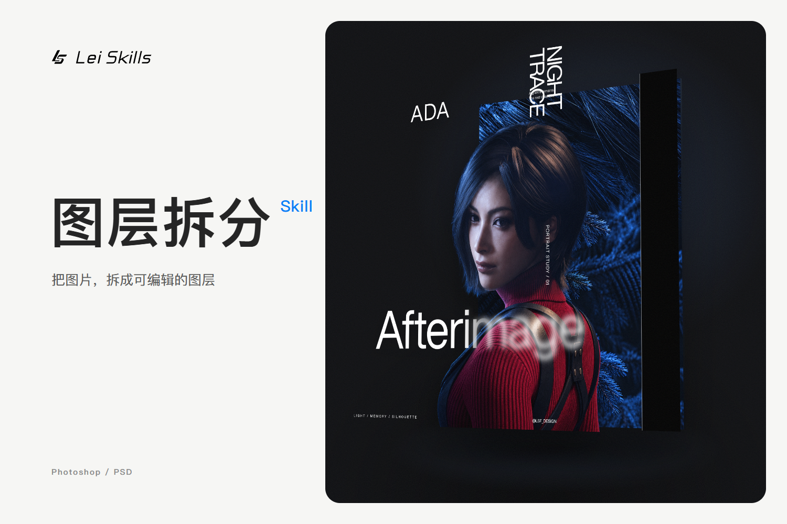

# 图层拆分 Skill · A 版封面



3:2，设计尺寸 1500 × 1000。使用实际海报的 11 张 PNG，按背景、侧栏、人物、字标、主标题和其他文字分成 6 个 CSS 3D 平面；默认展开，不自动播放动画。

## 预览

在仓库根目录启动静态服务：

```sh
python -m http.server 8000 --directory examples/cover
```

打开 http://localhost:8000/ 。ES 模块需要通过 HTTP 访问。

## 使用与修改

```html
<script type="module" src="./component.js"></script>
<div style="width:100%;aspect-ratio:3/2">
  <lei-layer-cover role="img" aria-label="图层拆分 Skill，展开图层" formats="Photoshop / PSD"></lei-layer-cover>
</div>
```

- composition.html：配色、字号、文案、图层分组、透视与展开坐标。
- element-template.js：组件封装、等比缩放和中英文文案。lang="en" 可切换英文。
- 修改后运行 node examples/cover/build.mjs，重新生成 component.js，无额外依赖。
- index.html：独立预览；preview.png：GitHub README 的静态展示图。网站使用实时 HTML/CSS 图层。

所有素材引用均为相对路径，可整体复制目录。字体使用系统字体，不附带字体文件。展示素材来自雷师傅提供的海报拆层案例，仅用于这个封面演示；不代表任何原图都能无损恢复，也不扩大仓库的 MIT 许可范围。此普通版仅交付 Photoshop / PSD。
